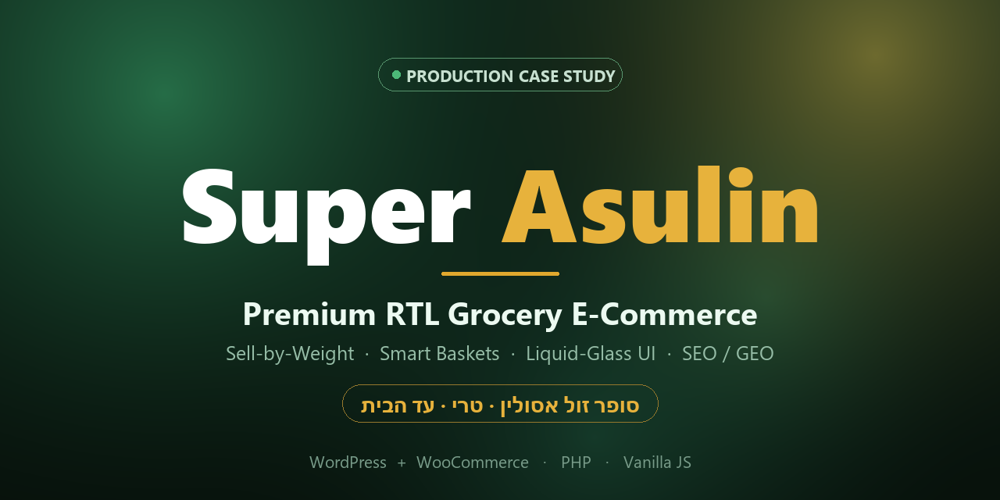
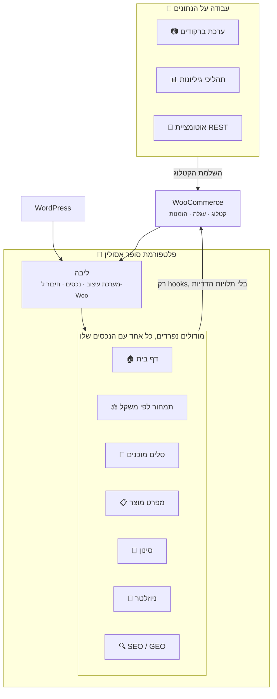
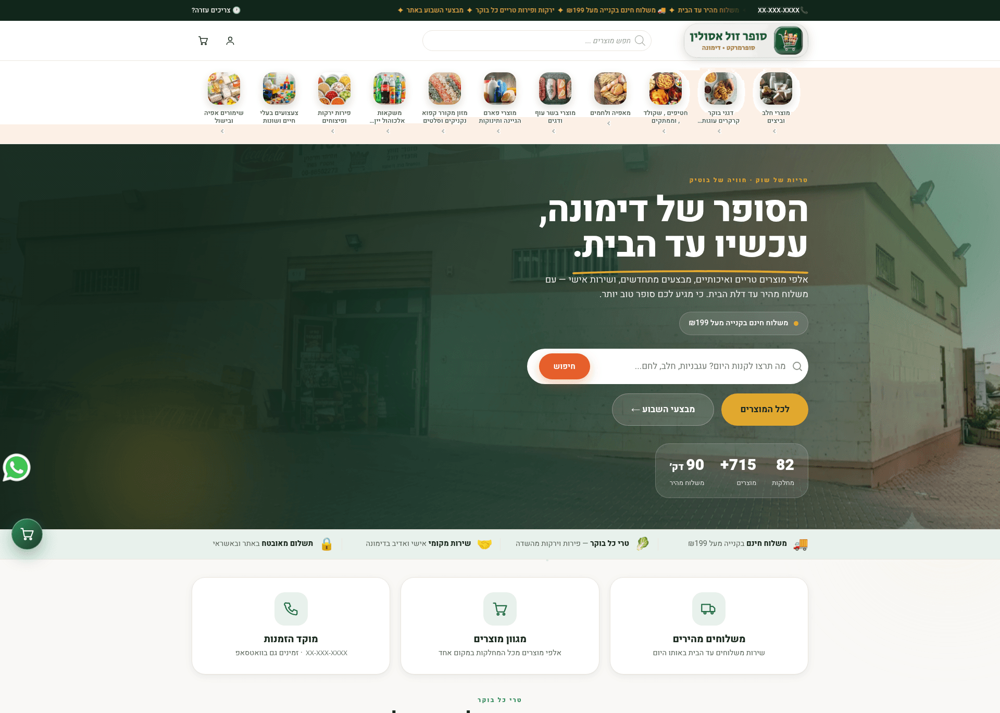
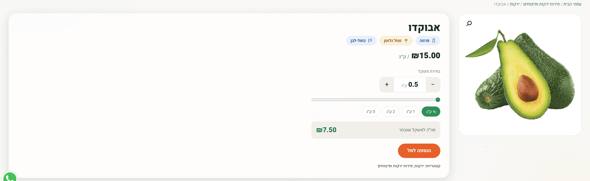
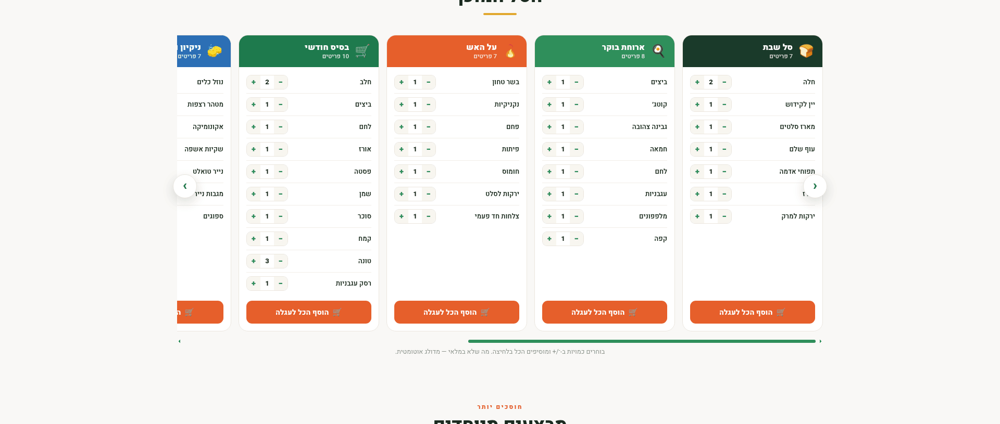
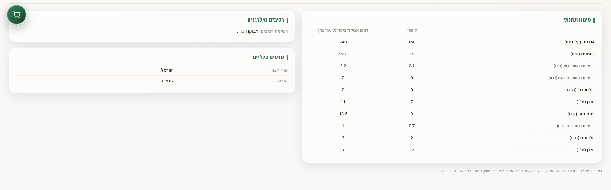
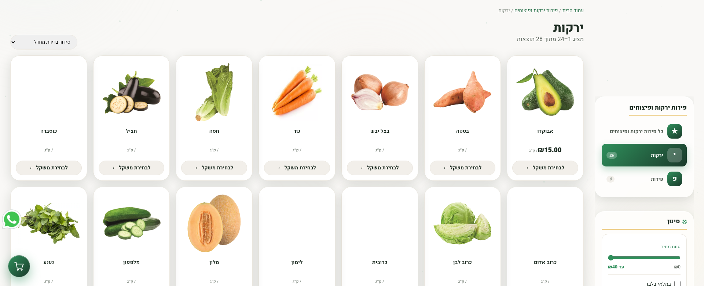
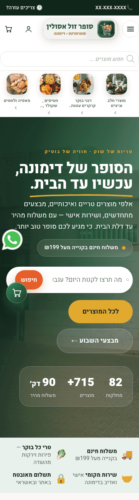

**[🇬🇧 English](README.md) · [🇮🇱 עברית](README.he.md)**

 

### פלטפורמת WordPress + WooCommerce שנבנתה מאפס, מקצה לקצה, בשביל סופרמרקט שכונתי אמיתי.

*מערכת עיצוב בוטיק · מנוע מכירה לפי משקל · סלים חכמים בלחיצה אחת · ממשק זכוכית נוזלית · עבודה על נתוני הקטלוג · SEO/GEO*

 

 

**[✨ לתצוגה האינטראקטיבית החיה ←](https://galasulin.github.io/super-asulin-showcase/)**
*אפשר לנסות את הסליידר של המכירה לפי משקל ואת הדמו של הסל החכם. זה שחזור נאמן שרץ על נתוני דמו בלבד.*

 

> **ריפו תצוגה.** הריפו מתעד מה הפרויקט יודע לעשות ואת ההחלטות ההנדסיות שמאחוריו.
> לא פורסמו כאן קוד מקור, פרטי גישה או נתונים עסקיים.

 

---

## 📖 הסיפור

סופרמרקט שכונתי עם **מאות מוצרים פעילים ביותר מ-80 מחלקות** ומשלוחים באותו יום רץ על תבנית חנות גנרית. האתר היה איטי, בלי זהות חזותית, ונאבק בתוספים של עצמו.

**סופר אסולין** החליף אותו בפלטפורמה שנבנתה כולה מאפס, מקובץ `style.css` ריק: דף בית ייעודי, **מנוע מכירה לפי משקל** לתוצרת טרייה, **סלים חכמים בלחיצה אחת**, **מערכת אחידה של דף מפרט** לכל מוצר עם תגי כשרות ותזונה, **מערכת עיצוב של זכוכית נוזלית** שמחזיקה את כל האתר, שחזור עגלות נטושות בעברית, ונתונים מובנים שמותאמים גם למנועי חיפוש וגם למנועי תשובות של AI. הכול **מימין לשמאל מהיסוד**.

מעבר לחנות עצמה, הפרויקט כלל **עבודה מלאה על נתוני הקטלוג**: ניקוי כפילויות אחרי ייבוא שהשתבש, הצלבה מול מאגר של יותר מ-7,000 שורות מוצרים, ו**ערכת סריקת ברקודים בטלפון**, כדי שבעל החנות יוכל להשלים פרטי מוצרים ישר מהמדף.

> **הגישה:** כל יכולת היא מודול נפרד שאפשר לכבות, עם נפילה רכה, ובלי שום תלות חובה בתוספים בתשלום. אפשר לכבות כל מודול מחר, והחנות ממשיכה למכור.

---

## ✨ היכולות המרכזיות

<table>
<tr>
<td width="33%" valign="top">

### ⚖️ מנוע מכירה לפי משקל
תמחור **לפי קילוגרם**, שמופעל מוצר-מוצר. הלקוח בוחר משקל בסליידר חי, מחצי קילו ועד 10 ק"ג בקפיצות של חצי קילו, והמחיר מתעדכן מיד. הוא עובר כמו שהוא לעגלה, לתשלום ולהזמנה.

</td>
<td width="33%" valign="top">

### 🧺 סלים מוכנים חכמים
שמונה סלים מוכנים: *שבת, ארוחת בוקר, על האש, קניות חודשיות, ניקיון, בריאות, אירוח, קפה ועוגה*. לכל פריט יש בורר כמות, ו**"הכול לעגלה" בנגיעה אחת**. פריט שאזל מדולג בשקט.

</td>
<td width="33%" valign="top">

### 📋 דף מפרט אחיד למוצר
תבנית אחת לכל מוצר: **תגי כשרות ותזונה** (ללא גלוטן, תוצרת הארץ, מצונן, קפוא), **טבלת ערכים תזונתיים** מלאה, רכיבים ואלרגנים, ארץ ייצור ואריזה. אותו מבנה בדיוק, גם כשחסרים נתונים.

</td>
</tr>
<tr>
<td valign="top">

### 💎 מערכת עיצוב של זכוכית נוזלית
פלטה של ירוק יער ודבש. כתום שמור אך ורק לכפתורי פעולה. כותרת זכוכית דביקה, מגה-תפריט של הקטגוריות החיות, טשטוש רקע, **כרטיסי מוצר אחידים** ומיקרו-אינטראקציות שמכבדות את `prefers-reduced-motion`.

</td>
<td valign="top">

### 🛒 המרה ושימור לקוחות
**מיילים בעברית לשחזור עגלות נטושות** עם התוכן החי של העגלה, אישור תנאים בתשלום, תהליך ביטול הזמנה, פופאפ ביציאה, עגלה צפה וכפתור צ'אט ב-WhatsApp.

</td>
<td valign="top">

### 📷 עבודה על נתוני הקטלוג
הסרה של **575 מוצרים כפולים** אחרי ייבוא שהשתבש, הצלבה מול **מאגר של 7,334 שורות מוצרים**, ו**סורק ברקודים במצלמת הטלפון** (HTML5, עובד גם בלי רשת), יחד עם תהליכי גיליונות להשלמת נתונים מהמדף.

</td>
</tr>
</table>

---

## 🧩 מפת המודולים

| # | מודול | מה הוא נותן |
|:-:|---|---|
| 01 | 🏠 **דף בית ייעודי** | כותרת Aurora · פס אמינות · יתרונות · קרוסלת טרי לפי משקל · 8 סלים חכמים · מבצעים · רשתות מומלצים וחדשים · המלצה מאומתת · ניוזלטר |
| 02 | ⚖️ **תמחור לפי משקל** | מנוע מחיר לק"ג · בורר חי · חיבור לעגלה ולהזמנה · תקן אחיד של חצי קילו |
| 03 | 🧺 **סלים מוכנים** | סלים מוכנים · בוררי כמות · הוספה מרוכזת לעגלה · דילוג על מה שאזל |
| 04 | 📋 **דף מפרט מוצר** | תגי כשרות ותזונה · טבלת ערכים · רכיבים ואלרגנים · ארץ ייצור. תבנית אחת אחידה |
| 05 | 🔎 **סינון מוצרים** | סינון רב-ממדי בצד השרת: קטגוריה · מחיר · מלאי · מבצע. בלי תוסף |
| 06 | 📨 **ניוזלטר ופופאפ יציאה** | מאגר נרשמים · לוח בקרה לניהול · ייצוא CSV · פופאפ יציאה שמופיע באמת רק פעם אחת |
| 07 | 💌 **שחזור עגלות** | רצפי מיילים בעברית עם התוכן החי של העגלה ותמונות המוצרים |
| 08 | 🔍 **SEO / GEO** | סכמת GroceryStore · JSON-LD למוצרים · תיאורים וביטויי מפתח שנוצרים אוטומטית בזמן הצגת הדף · GA4 + Search Console |
| 09 | 🎠 **קרוסלות ייעודיות** | גרירה לגלילה גם מעל קישורים · חצי ניווט · גלילה נצמדת. בלי ספריות |
| 10 | 📷 **ערכת ברקודים** | סורק במצלמת הטלפון (HTML5) · תהליכי CSV של רשימת ליקוט וסריקה מהירה · התאמה לנתוני המוצרים |

---

## 🏗️ ארכיטקטורה

**העקרונות**

- 🧱 **מודולים נפרדים.** אין תלויות ביניהם: מכבים מודול אחד, ושום דבר אחר לא נשבר.
- 🪶 **בלי תוספים כבדים.** הסינון, הניוזלטר, הקרוסלות, הפופאפים ודפי המפרט נבנו בעצמי.
- ♻️ **נפילה רכה.** כל שיפור יורד בבטחה כשהדפדפן לא תומך בו, כולל רשת ביטחון של `@supports`.
- 🌍 **מימין לשמאל קודם.** הפריסה, הקרוסלות והאינטראקציות מתהפכות נכון.
- ⚡ **מודע למטמון.** אסטרטגיית הנכסים בנויה סביב מטמון אגרסיבי של השרת וה-CDN (שם קובץ לפי hash של התוכן).

---

## 🛠️ הטכנולוגיה

| שכבה | הבחירות |
|---|---|
| **פלטפורמה** | ערכת עיצוב ייעודית ל-WordPress · חיבור עמוק ל-WooCommerce |
| **צד שרת** | PHP 7.2+ · ארכיטקטורה מודולרית מבוססת hooks · סוגי תוכן ייעודיים |
| **צד לקוח** | JavaScript נקי (בטוח ל-ES5, בלי פריימוורקים) · HTML5 סמנטי · ממשקי המצלמה של HTML5 |
| **עיצוב** | משתני CSS · Grid ו-Flexbox · `backdrop-filter` · טיפוגרפיה זורמת עם `clamp()` · מאפיינים לוגיים ל-RTL |
| **נתונים ו-SEO** | Schema.org JSON-LD · אוטומציה על ה-REST של WooCommerce · תהליכי Python/openpyxl · התאמת ברקודים |
| **אנליטיקה** | Google Analytics 4 · Search Console · מעקב אירועי מסחר |
| **תאימות** | Elementor Pro · FiboSearch · ערכות המטמון והאופטימיזציה הנפוצות |

---

## 🎨 טוקנים של העיצוב

| | טוקן | Hex | תפקיד |
|:-:|---|---|---|
| 🌲 | **יער** | `#11261B` | משטחים כהים · כותרת ופוטר · כותרת הדף |
| 🥬 | **ירוק טרי** | `#2F8F5B` | צבע המותג הראשי · תחושת טריות |
| 🍯 | **דבש** | `#E0A82E` | חיסכון והדגשות |
| 🔥 | **כתום פעולה** | `#E65F2B` | *אך ורק* כפתורי פעולה |
| 🤍 | **נייר חם** | `#F9F8F6` | רקע רגוע וטבעי |

טיפוגרפיה: סולם זורם עם `clamp()` · קצב ריווח של 8 נקודות · גיאומטריה אחידה לכרטיסים.
תנועה: מעברי Aurora · אפקט Ken-Burns בכותרת · הופעה בגלילה · הטיה ותאורה. הכול מאחורי `prefers-reduced-motion`.

---

## 📊 במספרים

| 🗂️ קטלוג | 🏬 מחלקות | 🧩 מודולים | 🧺 סלים | ⚖️ טווח משקל | 📄 מאגר ספקים | 🌐 RTL | 🔌 תוספים בתשלום |
|:-:|:-:|:-:|:-:|:-:|:-:|:-:|:-:|
| **700+** מוצרים | **80+** | **10** | **8** | **0.5–10 ק"ג** | **7,334** שורות | **100%** | **0** |

---

## 🔬 הערות הנדסיות שכדאי לקרוא

<b>⚖️ למה מנוע המשקל שומר גרמים ומציג קילוגרמים</b>

 

המחירים מוגדרים לק"ג, אבל כל החישוב הפנימי רץ בגרמים שלמים. כך אין סטייה של נקודה צפה בסכום העגלה. שכבת התצוגה הופכת `1500` ל-"1.5 ק"ג" רק ברגע האחרון. משקלים שונים של אותו מוצר הם שורות נפרדות בעגלה, לפי מפתח ייחודי. המחיר לק"ג נשמר ברגע ההוספה לעגלה, כך ששינוי מחיר מאוחר יותר לא משבש עגלה פתוחה.

<b>🎠 למה הקרוסלות עובדות עם אירועי עכבר ולא עם Pointer Events</b>

 

כרטיסי הקרוסלה של התוצרת הם קישורים שעוטפים תמונות, וגרירה רגילה של הדפדפן וניווט בקישור מתנגשים עם pointer-capture. הפתרון הסופי משתמש באירועי עכבר ברמת המסמך, עם `preventDefault`, ‏`draggable=false`, ביטול הלחיצה אחרי גרירה, וכיבוי של scroll-snap באמצע הגרירה. התוצאה: גרירה חלקה לגלילה שעובדת *גם מעל קישורים*, מימין לשמאל, בכל הדפדפנים שנבדקו.

<b>⚡ לשרוד מטמון אגרסיבי בצד השרת</b>

 

שרת האחסון מכווץ כל נכס ומגיש אותו מחדש בכתובת לפי hash של התוכן. אסטרטגיית הנכסים של ערכת העיצוב נבנתה סביב זה: קובץ חדש מקבל hash חדש באופן אוטומטי, דריסות קריטיות יוצאות בקבצים ייעודיים שנטענים מאוחר, ו-`@supports` מבטיח שדפדפן ישן לא יראה אפקט זכוכית שבור.

<b>🔍 SEO שמכסה גם מוצרים שעוד לא קיימים</b>

 

התיאורים וביטויי המפתח נוצרים ב-filter hooks בזמן הצגת הדף, ולא נכתבים למסד לכל מוצר בנפרד. כל מוצר עתידי מקבל תיאור עשיר ומותאם לשפה מהרגע שהוא מתפרסם.

<b>🧹 שיקום קטלוג שהשתבש בלי להוריד את האתר</b>

 

ייבוא CSV שהשתבש יצר בלילה אחד 575 מוצרים כפולים. השיקום רץ בפעולות מרוכזות שהוגבלו לפי תאריך, על החנות החיה: רק הכפולים הועברו לפח, נבדק שהמקוריים נשארו שלמים (עם התמונות והשיוך לקטגוריות), והספירות הסופיות הוצלבו. האתר לא ירד אפילו לרגע, ואף מוצר לא אבד.

<b>📷 סורק ברקודים שרץ בטלפון של בעל החנות</b>

 

כדי להשלים את פרטי המוצרים היה צריך ברקוד כמפתח להצלבה מול מאגר של 7,334 שורות. במקום חומרה ייעודית, הפרויקט כלל סורק HTML5 עצמאי: מצלמת הטלפון, פענוח חי, שמירה מקומית וייצוא CSV. הוא מוגש ב-HTTPS, כך ש-`getUserMedia` עובד בכל מקום בחנות. שלושה תהליכי עבודה (רשימת ליקוט, אפליקציה וסריקה מהירה) נותנים לבעל החנות לבחור בין מהירות לוודאות. גרסה מאוחרת יותר של הסורק, שמסתנכרנת לענן, פתוחה לכולם: [supermarket-barcode-scanner](https://github.com/galasulin/supermarket-barcode-scanner).

---

## 🖼️ גלריה

**🏠 דף הבית**: כותרת Aurora, כותרת זכוכית דביקה, פס אמינות ויתרונות

**⚖️ מנוע המכירה לפי משקל**: תגי תזונה מתחת לשם המוצר, מחיר לק"ג, סליידר חי (קפיצות של חצי קילו), משקלים מוכנים וסכום שמתעדכן מיד

**🧺 סלים מוכנים חכמים**: סלים עם בורר כמות לכל פריט והוספה מרוכזת בנגיעה אחת

**📋 דף מפרט אחיד**: טבלת ערכים תזונתיים מלאה, רכיבים ואלרגנים, ארץ ייצור. אותו מבנה לכל מוצר

**🔎 סינון רב-ממדי**: ניווט במחלקות, סליידר טווח מחירים, מתגי מלאי ומבצע. מימין לשמאל, מהשרת

**📱 מובייל**: כל החוויה בטלפון: תפריט המבורגר, כותרת הדף ופס אמינות בשתי עמודות

---

## 💥 תוצאות והשפעה

- 🎯 **זהות חזותית משלה.** ערכת עיצוב ייעודית במקום תבנית מדף.
- 🛒 **מכירה לפי משקל וסלים בנגיעה אחת.** שני התהליכים שקוני מכולת משתמשים בהם הכי הרבה, בנויים מהיסוד.
- 🧭 **תוצרת טרייה נמכרת כמו שצריך.** לפי קילו, עם מחיר חי, בדיוק כמו שהלקוח חושב עליה.
- ♻️ **פחות תחזוקה ופחות עלות.** תוספים כבדים בתשלום הוחלפו במודולים שנבנו בעצמי. פחות דברים שיכולים להישבר, ושום מנוי לחדש.
- 🔍 **רואים אותה במפה.** נתונים מובנים ותיאורים אוטומטיים הופכים את החנות לקריאה ל-Google ולמנועי תשובות של AI.
- 📱 **מובייל קודם, לקהל של מובייל.** שם קורות רוב הקניות במכולת.

---

## 🧠 מיומנויות שבאות לידי ביטוי

`ארכיטקטורת צד לקוח` · `פיתוח ערכות עיצוב ל-WordPress` · `חיבור עמוק ל-WooCommerce` · `Vanilla JS` · `CSS מודרני / Glassmorphism` · `RTL / i18n` · `UI/UX ומערכות עיצוב` · `ביצועים ומטמון` · `SEO / נתונים מובנים` · `אנליטיקה (GA4)` · `הנדסת נתוני קטלוג` · `כלים ב-Python`

---

## 🗺️ מה הלאה

- [ ] **PWA**: חנות שאפשר להתקין ושעובדת גם בלי רשת
- [ ] מודול **מועדון לקוחות וקופונים**
- [ ] **מעקב משלוח חי** להזמנות של אותו יום
- [ ] **בדיקות A/B** על תהליכי המכירה לפי משקל והסלים
- [ ] **עוד סלים מוכנים** לפי עונה ולפי נתוני רכישה

---

## 👤 מי בנה

תוכנן ונבנה מקצה לקצה על ידי **[גל אסולין](https://github.com/galasulin)**: הארכיטקטורה, מערכת העיצוב וה-UI/UX, צד הלקוח, החיבור ל-WooCommerce, שכבת ה-SEO, האנליטיקה והכלים לנתוני הקטלוג.

 

**Built by [Gal Asulin](https://github.com/galasulin), IT Manager**

כלי הברקודים (קוד פתוח): <a href="https://github.com/galasulin/supermarket-barcode-scanner">supermarket-barcode-scanner</a>

 

