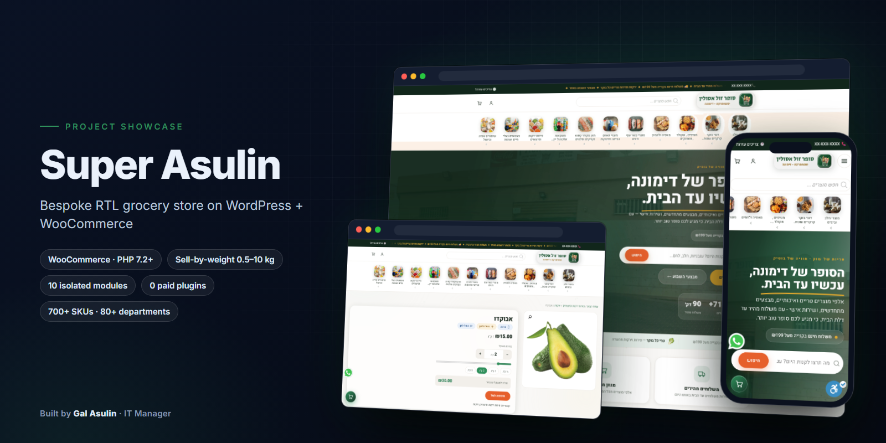
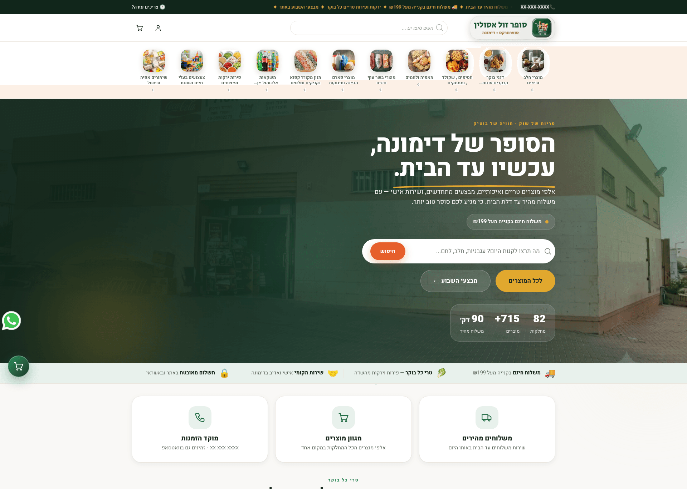
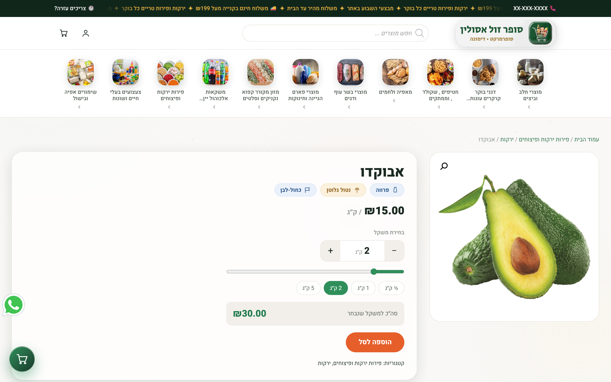
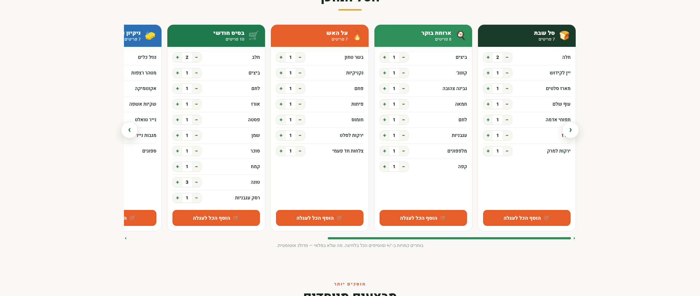
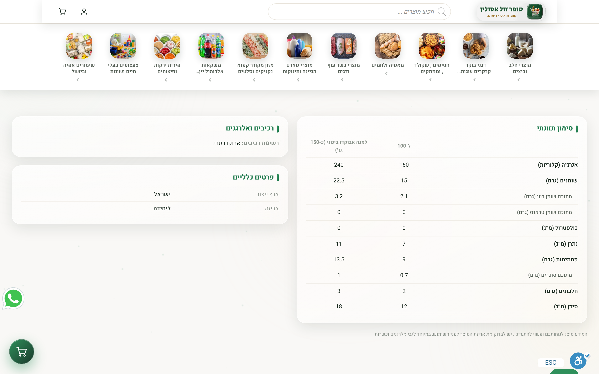
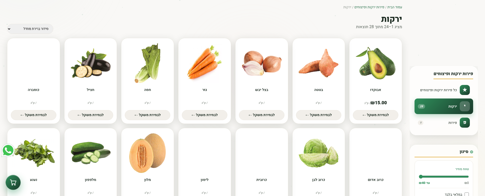
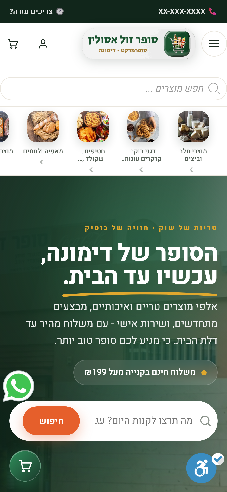
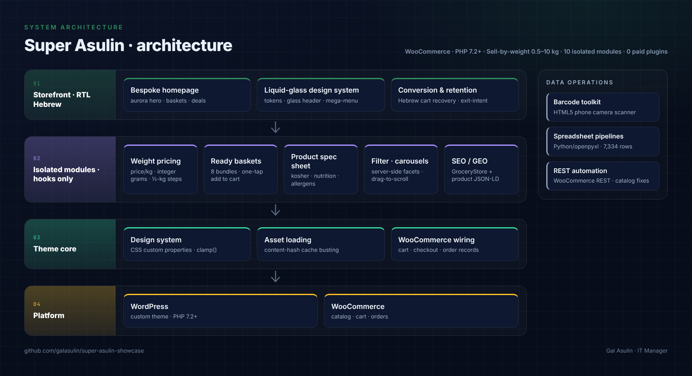
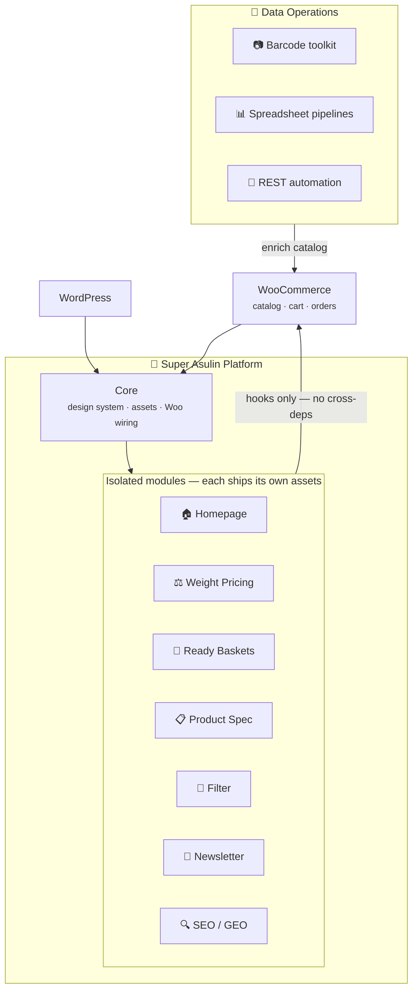

<p align="center"><a href="https://galasulin.github.io/super-asulin-showcase/"></a></p>

<h1 align="center">Super Asulin · RTL Grocery E-Commerce</h1>

<p align="center">A bespoke WordPress + WooCommerce platform, built end-to-end for a real neighborhood supermarket.</p>

<p align="center"><a href="README.md">🇬🇧 English</a> · <a href="README.he.md">🇮🇱 עברית</a></p>

<div align="center">


**[Live showcase](https://galasulin.github.io/super-asulin-showcase/) · [Screens](#-screens) · [Architecture](#-architecture) · [Tech](#-technical-parameters)**

</div>

> **Showcase repository.** This repo documents the project's capabilities and engineering decisions. No source code, credentials, or business data are published here. The [live interactive showcase](https://galasulin.github.io/super-asulin-showcase/) lets you try the sell-by-weight slider and the smart-basket demo: faithful recreations, demo data only.

---

## 📋 At a glance

| | |
|---|---|
| **Type** | Production e-commerce store · custom WordPress theme (case study) |
| **Status** | In production |
| **Stack** | WordPress · WooCommerce · PHP 7.2+ · vanilla JS · CSS custom properties |
| **My role** | Architecture, UI/UX design system, front-end, WooCommerce integration, SEO, analytics, catalog data tooling |
| **Live demo** | [galasulin.github.io/super-asulin-showcase](https://galasulin.github.io/super-asulin-showcase/) |
| **Languages** | Store: Hebrew (RTL) · Docs: English / Hebrew |

---

## 📸 Screens

<table>
<tr>
<td width="33%"><a href="screenshots/01-homepage-hero.png"></a><br><sub><b>Homepage</b> · aurora hero, sticky glass header, trust bar</sub></td>
<td width="33%"><a href="screenshots/02-fresh-by-weight.png"></a><br><sub><b>Sell-by-weight</b> · price/kg, live slider in ½-kg steps</sub></td>
<td width="33%"><a href="screenshots/03-ready-baskets.png"></a><br><sub><b>Smart ready-baskets</b> · per-item steppers, one-tap add</sub></td>
</tr>
<tr>
<td width="33%"><a href="screenshots/04-product-spec.png"></a><br><sub><b>Product spec sheet</b> · nutrition, allergens, provenance</sub></td>
<td width="33%"><a href="screenshots/05-filter.png"></a><br><sub><b>Faceted filter</b> · departments, price range, stock, sale</sub></td>
<td width="33%"></td>
</tr>
</table>

<table>
<tr>
<td align="center"><a href="screenshots/06-mobile.png"></a><br><sub><b>Mobile</b> · hamburger nav, hero, 2-up trust bar</sub></td>
</tr>
</table>

---

## 🧭 What it is

A neighborhood supermarket with **hundreds of live SKUs across 80+ departments** and same-day delivery was running on a generic store template: slow, visually anonymous, and fighting its own plugins. **Super Asulin** replaced it with a custom platform built from a blank `style.css`: a custom homepage, a sell-by-weight engine for fresh produce, one-click smart baskets, a uniform product spec sheet, a liquid-glass design system, Hebrew cart recovery and structured data for search and AI answer engines, all native right-to-left. The project also covered catalog data operations: deduplicating a corrupted import, cross-referencing a 7,334-row dataset, and a phone barcode-scanning toolkit for shop-floor enrichment.

> **Design philosophy:** every feature is an isolated, toggleable module with graceful fallbacks, and zero hard dependencies on paid plugins. Disable any module tomorrow; the store keeps selling.

---

## 🧩 Key capabilities

<table>
<tr>
<td width="33%" valign="top">

**⚖️ Sell-by-weight engine**<br>
Per-product opt-in pricing **per kilogram**. Customers pick a weight on a live slider, 0.5 to 10 kg in ½-kg steps, and the price recalculates in real time, flowing through cart, checkout and order records.

</td>
<td width="33%" valign="top">

**🧺 Smart ready-baskets**<br>
Eight curated bundles: *Shabbat, Breakfast, BBQ, Monthly Staples, Cleaning, Healthy, Hosting, Coffee & Cake*. Per-item quantity steppers and **"add everything to cart" in one tap**; out-of-stock items are skipped.

</td>
<td width="33%" valign="top">

**📋 Uniform product spec system**<br>
One template for every product: **kosher and dietary badges** (gluten-free, Israeli-made, chilled, frozen), a full **nutrition table**, ingredients and allergens, provenance and packaging. Identical layout with or without data.

</td>
</tr>
<tr>
<td valign="top">

**💎 Liquid-glass design system**<br>
Forest-green and honey palette, orange reserved strictly for CTAs. Sticky glass header, mega-menu of live categories, backdrop blur, **uniform product cards**, micro-interactions that respect `prefers-reduced-motion`.

</td>
<td valign="top">

**🛒 Conversion & retention**<br>
**Abandoned-cart recovery emails in Hebrew** with live cart contents, checkout terms consent, order-cancellation flow, exit-intent popup, floating cart and WhatsApp click-to-chat.

</td>
<td valign="top">

**📷 Catalog data ops**<br>
Removed **575 duplicate products** from a bad import, cross-referenced a **7,334-row product dataset**, and shipped a **phone-camera barcode scanner** (HTML5, offline-capable) plus spreadsheet pipelines for shop-floor enrichment.

</td>
</tr>
</table>

### Module map

| # | Module | Delivers |
|:-:|---|---|
| 01 | 🏠 **Bespoke Homepage** | Aurora hero · trust bar · value props · fresh-by-weight carousel · 8 smart baskets · deals · featured & new grids · verified testimonial · newsletter |
| 02 | ⚖️ **Weight Pricing** | Price/kg engine · live selector · cart & order integration · uniform ½-kg standard |
| 03 | 🧺 **Ready Baskets** | Curated bundles · quantity steppers · bulk add-to-cart · stock-aware skipping |
| 04 | 📋 **Product Spec Sheet** | Kosher/dietary badges · nutrition table · ingredients & allergens · provenance; one uniform template |
| 05 | 🔎 **Product Filter** | Faceted server-side filtering: category · price · stock · sale; plugin-free |
| 06 | 📨 **Newsletter + Exit-Intent** | Subscriber store · admin dashboard · CSV export · true one-time exit popup |
| 07 | 💌 **Cart Recovery** | Hebrew email sequences with live cart contents & product images |
| 08 | 🔍 **SEO / GEO** | GroceryStore schema · product JSON-LD · render-time meta & keyphrase automation · GA4 + Search Console |
| 09 | 🎠 **Custom Carousels** | Drag-to-scroll over links · arrow nav · snap scrolling; dependency-free |
| 10 | 📷 **Barcode Toolkit** | Phone-camera scanner (HTML5) · pick-list & fast-scan CSV workflows · product-data matching |

---

## 🧱 Architecture



WordPress and WooCommerce provide the base: catalog, cart and orders. On top sits the theme **core** (design system, asset loading, WooCommerce wiring), and on the core sit **isolated modules**: homepage, weight pricing, ready baskets, product spec, filter, newsletter and SEO/GEO. Each module ships its own assets and talks to WooCommerce through hooks only, with no cross-dependencies, so any one can be switched off without breaking the others. A separate **data-operations** track (barcode toolkit, spreadsheet pipelines, REST automation) enriches the WooCommerce catalog from outside the storefront.

### Flow



**Principles**

- 🧱 **Isolated modules**: no cross-dependencies; disable any module, nothing else breaks.
- 🪶 **Zero heavy plugins**: filter, newsletter, carousels, popups and spec sheets built natively.
- ♻️ **Graceful fallbacks**: every enhancement degrades safely, `@supports` safety nets included.
- 🌍 **RTL-first**: layout, carousels and interactions all mirror correctly.
- ⚡ **Cache-aware**: asset strategy built around aggressive edge/CDN caching (content-hash busting).

---

## 📐 Technical parameters

| Parameter | Value |
|---|---|
| Platform | WordPress custom theme · WooCommerce deep integration |
| Backend | PHP 7.2+ · hook-driven modular architecture · custom post types |
| Frontend | Vanilla JavaScript (ES5-safe, zero frameworks) · semantic HTML5 · HTML5 camera APIs |
| Styling | CSS custom properties · Grid & Flexbox · `backdrop-filter` · fluid `clamp()` type · logical properties for RTL · 8-pt spacing rhythm |
| Data & SEO | Schema.org JSON-LD · WooCommerce REST automation · Python/openpyxl pipelines · barcode matching |
| Analytics | Google Analytics 4 · Search Console · e-commerce event tracking |
| Compatibility | Elementor Pro · FiboSearch · major caching/optimization stacks |
| Catalog | **700+** SKUs · **80+** departments |
| Modules | **10** |
| Ready baskets | **8** |
| Weight range | **0.5–10 kg** in ½-kg steps; internal math in integer grams |
| Supplier dataset | **7,334** rows |
| Duplicates removed | **575** products, zero downtime |
| RTL coverage | **100%** |
| Paid plugins | **0** |
| Live showcase | One self-contained `index.html` (47 KB): inline CSS and one inline script, no external libraries |

### Design tokens

| | Token | Hex | Role |
|:-:|---|---|---|
| 🌲 | **Forest** | `#11261B` | Dark surfaces · header/footer · hero |
| 🥬 | **Fresh Green** | `#2F8F5B` | Primary brand · freshness cue |
| 🍯 | **Honey** | `#E0A82E` | Savings & accents |
| 🔥 | **CTA Orange** | `#E65F2B` | *Strictly* calls-to-action |
| 🤍 | **Warm Paper** | `#F9F8F6` | Calm organic canvas |

Typography: fluid `clamp()` scale · 8-pt spacing rhythm · uniform card geometry.
Motion: aurora gradients · Ken-Burns hero · reveal-on-scroll · tilt & spotlight, all behind `prefers-reduced-motion`.

---

## 🧠 Engineering decisions

<details>
<summary><b>⚖️ Weight engine stores grams, displays kilograms</b> → no floating-point drift in cart totals</summary>
<br/>

Prices are defined per kg, but all internal math runs in integer grams, which eliminates floating-point drift in cart totals. The display layer formats `1500 → "1.5 kg"` at the last moment. Different weights of the same product become separate cart lines via unique keys, and the per-kg price is snapshotted at add-to-cart time so later price edits never corrupt an open cart. Trade-off: a unit conversion at the display boundary.

</details>

<details>
<summary><b>🎠 Carousels use mouse events, not Pointer Events</b> → drag-to-scroll that works over links</summary>
<br/>

The produce carousel cards are anchor tags wrapping images; native drag ghosting and link navigation fight pointer-capture. The final implementation uses document-level mouse events with `preventDefault`, `draggable=false`, click-suppression after drag, and disables scroll-snap mid-drag. Result: smooth drag-to-scroll that works *over links*, in RTL, on every browser tested. Trade-off: more hand-written event handling than a pointer-capture one-liner.

</details>

<details>
<summary><b>⚡ Asset strategy built around aggressive server-side caching</b> → updates reach users without manual purges</summary>
<br/>

The production host minifies and re-serves every asset under content-hash URLs. The theme's asset strategy was designed around that: new files get new hashes automatically, critical overrides ship in dedicated late-loading files, and `@supports` fallbacks guarantee older browsers never see a broken glass effect. Trade-off: some overrides live in separate late-loading files.

</details>

<details>
<summary><b>🔍 Meta generated at render time</b> → SEO covers products that don't exist yet</summary>
<br/>

Meta descriptions and focus keyphrases are generated by filter hooks at render time, not written into the database per product. Every future product inherits rich, localized meta automatically the moment it's published. Trade-off: per-product meta follows a shared pattern rather than hand-written copy.

</details>

<details>
<summary><b>🧹 Date-scoped batch recovery on the live store</b> → corrupted catalog fixed with zero downtime</summary>
<br/>

A bad CSV import created 575 duplicate products overnight. Recovery used date-scoped batch operations against the live store: trashing only the duplicates, verifying originals (with their images and category assignments) survived intact, and cross-checking final counts. Zero downtime, zero lost products.

</details>

<details>
<summary><b>📷 Barcode scanner on the owner's phone, not dedicated hardware</b> → enrichment from the shop floor</summary>
<br/>

Product enrichment needed barcodes as a join key against a 7,334-row product dataset. Instead of dedicated hardware, the project shipped a self-contained HTML5 scanner (phone camera, live decode, local storage, CSV export) hosted over HTTPS so `getUserMedia` works anywhere in the store. Three workflows (pick-list, app, fast-scan) let the owner choose speed vs. certainty. A later cloud-synced version of the scanner is open source: [supermarket-barcode-scanner](https://github.com/galasulin/supermarket-barcode-scanner).

</details>

---

## 💥 Results & impact

- 🎯 **Own visual identity**: a custom theme instead of a stock template.
- 🛒 **Sell-by-weight and one-tap baskets**: the two flows grocery shoppers use most, built natively.
- 🧭 **Fresh produce sold *its* way**: by the kilo, with a live price, exactly how customers think about it.
- ♻️ **Lower maintenance & cost**: heavyweight paid plugins replaced by native modules; less to break, nothing to renew.
- 🔍 **Found on the map**: structured data + automated meta make the store legible to Google and AI answer engines.
- 📱 **Mobile-first for a mobile audience**: where most grocery shopping actually happens.

## 🛠️ Skills demonstrated

`Front-end Architecture` · `WordPress Theme Development` · `WooCommerce Deep Integration` · `Vanilla JS` · `Modern CSS / Glassmorphism` · `RTL / i18n` · `UI/UX & Design Systems` · `Performance & Caching` · `SEO / Structured Data` · `Analytics (GA4)` · `Catalog Data Engineering` · `Python Tooling`

## 🗺️ What's next

- [ ] **PWA**: installable, offline-ready storefront
- [ ] **Loyalty & coupons** module
- [ ] **Live delivery tracking** for same-day orders
- [ ] **A/B testing** on the sell-by-weight & basket flows
- [ ] **More curated baskets** driven by seasonal & purchase data

---

## 📁 Repository layout

```
super-asulin-showcase/
├── README.md            English case study
├── README.he.md         Hebrew case study (RTL)
├── index.html           Live interactive showcase (GitHub Pages, self-contained)
├── showcase.html        Redirect to the showcase page
├── .nojekyll            Serve the site as-is on GitHub Pages
├── assets/banner.png    Social preview image (1280×640)
├── screenshots/         01–05 desktop (1920 px wide) · 06 mobile (360 px)
└── docs/showcase/       hero.png · architecture.png
```

---

## 🔐 Privacy & scope

This is a **showcase repository**: it documents the project's capabilities and engineering decisions. **No source code, credentials, or business data are published here.** The live showcase runs faithful recreations of the weight slider and the smart basket on **demo data only**. The open-source barcode tooling lives in its own repo: [supermarket-barcode-scanner](https://github.com/galasulin/supermarket-barcode-scanner).

---

<div align="center"><b>Built by <a href="https://github.com/galasulin">Gal Asulin</a>, IT Manager</b></div>
